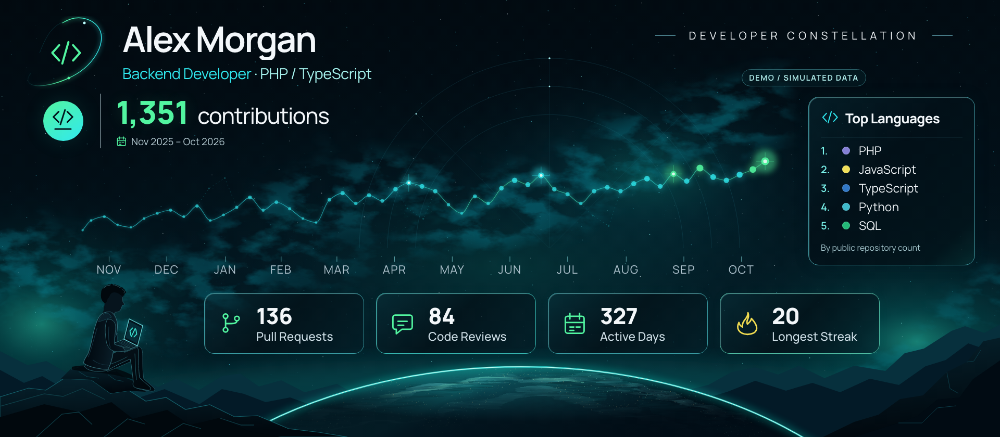

# Git Constellation

Git Constellation turns a GitHub contribution calendar into a panoramic, constellation-inspired image that you can link from your profile README. A GitHub Action regenerates it on a schedule, so the image stays current without cloning or installing anything. It can also run locally, in a demo mode with fictional data or in a live mode with your own token.


This is the author's live profile image, regenerated every 6 hours by the action.

## Quick Start (GitHub Actions)

It runs in your profile repository (`<login>/<login>`).

1. **Add the workflow.** Copy [examples/profile-workflow.yml](examples/profile-workflow.yml) to `.github/workflows/constellation.yml` in your profile repository and set `name`, `role` and `stack`. Then open the Actions tab and press **Run workflow** once.
2. **Optional: include private activity.** See [Tokens and privacy](#tokens-and-privacy).
3. **Add the image to your README:**

   ```html
   /<login>/constellation/constellation.svg" width="100%" alt="GitHub contribution constellation for <login>">
   ```

   The animated SVG is about 300 KB. Use `constellation.png` in the same place for a static image. A viewer that does not animate the SVG shows the plain image, because every animated element is invisible at rest. The SVG also carries a `prefers-reduced-motion` rule, which has not been confirmed to apply through `` in every browser. See [docs/phase-4.md](docs/phase-4.md).

The runner must provide PHP 8.3 or later and Composer; the example uses `ubuntu-24.04`. Node.js is set up automatically when the runner's version is too old.

## Configuration

Set these under `with:` in the workflow. All inputs are optional.

| Input | Default | Description |
| --- | --- | --- |
| `token` | `${{ github.token }}` | Token used only to read statistics. |
| `username` | repository owner | GitHub login to render. |
| `name` | empty | Name shown on the image. |
| `role` | empty | Role shown on the image. |
| `stack` | empty | Stack shown on the image. |
| `period` | `all-time` | `all-time` or `last-year`. |
| `languages` | empty | JSON list of 1 to 5 languages to show instead of the ranking, for example `["PHP", {"name": "TypeScript", "color": "#3178c6"}]`. |
| `exclude-languages` | empty | JSON list of language names that replaces the default exclusion list. |
| `colors` | empty | JSON object with optional `cyan` and `green` colors, for example `{"cyan": "#30e8ef"}`. |
| `config` | empty | Path to a JSON config file in your repository (requires `actions/checkout`). Non-empty inputs override its keys. |
| `branch` | `constellation` | Branch that receives the image. |
| `path` | `constellation.png` | File name of the PNG in that branch. The animated SVG is published next to it, with `.svg` in place of `.png`. |
| `commit-message` | `Update Git Constellation image` | Commit message for the published image. |

The inputs match the configuration keys described under [Advanced Setup (local)](#advanced-setup-local). See [docs/phase-3.md](docs/phase-3.md) for the design.

## Tokens and privacy

- **Default:** the automatic `GITHUB_TOKEN`. The image shows public statistics, plus anonymized private counts only if you share them on your profile.
- **Private counts:** create a classic token with **only** the `read:user` scope, store it as the repository secret `CONSTELLATION_TOKEN` and uncomment the `token:` line in the workflow. Never grant `repo`: it is not needed, and a token with `repo` is rejected.
- **Fine-grained tokens** also work, but their Pull Requests and Code Reviews counts are public only, so the classic `read:user` token is recommended.
- If the `token:` line references a secret that does not exist, the run fails with a clear error.
- Publishing always uses the automatic `GITHUB_TOKEN` (the workflow grants `contents: write`), passed only to the push command. The personal token is only used to read statistics.
- The job log shows only the aggregate summary, never repository names or the token.
- Demo mode makes no GitHub calls and needs no credentials.
- The tool reads only the contribution calendar, aggregate totals and, for the language ranking, language names and colours of public repositories. It never reads code and never exposes repository names, branches, commit messages or pull request titles.

Never put a token in the repository, in `config/*.json`, in command arguments or in generated files. `.env` and `config/local.json` are gitignored; `.env.example` is the only committed template and contains no token.

## Schedule and the `constellation` branch

The workflow runs every 6 hours (`cron: '0 */6 * * *'`, UTC) and on demand. Edit the cron line to change the schedule.

The image lives on the `constellation` branch, which holds a single commit replaced on each run, so your main branch gets no bot commits. To store it on your default branch instead, set `branch:` to that branch; it then gets a normal commit only when the image changes, and the `` URL uses that branch name (for example `main`) instead of `constellation`. The action refuses to overwrite an existing branch it did not create. If a run fails, nothing is published and the previous image stays.

GitHub disables scheduled workflows in public repositories after 60 days without repository activity. If that happens, re-enable the workflow in the Actions tab (select it and press **Enable workflow**). Storing the image on the default branch avoids this, because each changed image is a commit there.

## Versions

Pin the action as `@v1` (latest 1.x, recommended), `@latest` (newest release, may include breaking changes) or an exact `@vX.Y.Z`.

## Advanced Setup (local)

Run the generator on your own machine, for the demo image or for live statistics with your own token.

### Requirements

- PHP 8.3 or later and Composer.
- Node.js 24 and npm. The version is pinned in `.nvmrc`.
- Chromium installed for Playwright.

### Project structure

```text
.
├── .github/workflows/     # CI for this repository
├── action.yml             # Composite GitHub Action (Quick Start)
├── assets/
│   ├── constellation.css  # Composition styles
│   ├── fonts/             # Manrope and its OFL license
│   └── space.svg          # Provisional background artwork
├── bin/                   # PHP CLI
├── build/                 # Compiled TypeScript and render data (generated)
├── config/                # demo.json and live.example.json
├── dist/                  # Generated images
├── docs/                  # Phase documentation and release procedure
├── examples/              # Profile workflow to copy (Quick Start)
├── fixtures/              # Fictional calendar and metadata for demo mode
├── renderer/              # TypeScript exporter, icons and SVG/HTML rendering
├── scripts/action/        # Action helpers: run configuration and image publishing
├── src/
│   ├── Cli/               # Arguments, command coordination and live summary
│   ├── Config/            # Configuration and environment (token) loading
│   ├── Data/              # Fixture, calendar, period and render data
│   ├── GitHub/            # GraphQL client, queries and live statistics
│   ├── Render/            # Safe invocation of the Node process
│   ├── Statistics/        # Metrics, language ranking, private contributions state
│   └── Support/           # JSON reading and writing
└── tests/
    ├── action/            # Publishing test against a temporary bare repository
    ├── php/               # PHPUnit tests (tests/php/Integration needs real credentials)
    ├── ts/                # Vitest tests
    └── visual/            # Playwright visual tests
```

`build/`, `dist/`, `vendor/` and `node_modules/` are generated locally and are not tool source code.

### Dependencies

Composer installs Symfony HttpClient and Symfony Dotenv (used only by live mode) and PHPUnit (development). Demo mode makes no HTTP calls.

The npm development dependencies are TypeScript (compiles the ESM modules), `@playwright/test` (the rendering browser and the visual tests) and Vitest (transform tests). `@types/node` only supplies types to the compiler and is not part of the runtime. Playwright uses Chromium to export the images.

### Install and generate the demo

From the project root:

```sh
composer install
npm ci
npx playwright install chromium
npm run build
php bin/constellation --demo
```

The CLI uses `config/demo.json` and `fixtures/demo.json` by default. It prepares `build/data.json` and calls `node build/renderer/export.js --input build/data.json --output <png>` to produce `dist/constellation.png`. Override paths with `--config=...`, `--fixture=...` and `--output=...`; relative paths resolve from the project root. `php bin/constellation --help` prints usage. `composer run demo` runs the default command.

Demo data has a fixed period so the image is reproducible. It needs no token and no access to GitHub. Each run writes `dist/constellation.png`, its animated version `dist/constellation.svg` and, by default, `dist/constellation.html`. When calling the Node exporter directly you can add `--no-html` to skip the HTML file; the PHP command always uses the default output.

The demo image below uses simulated data (the fictional developer "Alex Morgan") and is 1920 x 840 pixels:



### Demo configuration

`config/demo.json`:

```json
{
  "username": "demo-developer",
  "name": "Alex Morgan",
  "role": "Backend Developer",
  "stack": "PHP / TypeScript",
  "output": "dist/constellation.png",
  "colors": {
    "cyan": "#30e8ef",
    "green": "#52f5a0"
  }
}
```

The keys are `username`, `name`, `role`, `stack`, `output` and `colors.cyan` / `colors.green`. Live mode uses the same keys, with `username` set to a real GitHub login, plus the optional `period` (see [Period](#period)); demo mode ignores `period`. `config/live.example.json` is a ready template.

### Live mode

Live mode fetches real statistics for one GitHub user and renders them with the same renderer. By default it shows the user's whole history, from the first contribution to today (see [Period](#period)). It needs a token and network access to `api.github.com`.

1. **Create a token.** On GitHub, go to Settings, Developer settings, Personal access tokens, Tokens (classic). Create a classic token with **only** the `read:user` scope. Do not grant `repo`: a token that reports it is rejected. Fine-grained tokens work with caveats; see Known limitations below.
2. **Store the token.** Either export it for the session, or copy `.env.example` to `.env` and set it there. `.env` is gitignored.

   ```sh
   cp .env.example .env
   # edit .env: GITHUB_TOKEN=<your token>
   ```

   The process environment wins over `.env`. The token is never exported to child processes and never reaches the Node renderer.
3. **Create your configuration.** `config/local.json` is gitignored and is the default for `--live`.

   ```sh
   cp config/live.example.json config/local.json
   # edit config/local.json: username, name, role, stack, colors, period
   ```
4. **Run it.**

   ```sh
   php bin/constellation --live
   ```

   Use `--config=...` and `--output=...` to override the defaults. The image is written to `dist/live.png`, with the animated version in `dist/live.svg`; `dist/constellation.png` and `dist/constellation.svg` remain the demo files. To embed a locally generated PNG, commit it to a public repository and link its raw URL; the [Quick Start](#quick-start-github-actions) does this automatically.

### Reading the summary

Before rendering, the command prints a summary of what was fetched:

```text
LIVE — GitHub statistics for <login>
Period (UTC): [all-time, ]<start> .. <end>
Generated at: <UTC timestamp>
Contributions (calendar): <n>
Private contributions: <included|excluded|unknown> (restricted count: <n>, own account: yes|no)
Pull Requests (visible to token): <n>
Code Reviews (visible to token): <n>
Active Days: <n>
Longest Streak: <n>
Repositories scanned (public, non-fork): <n>
Top Languages: <name> (<repositories>), ...
(or, with a manual list: Top Languages (selected): <name>, ...)
Token scopes: <scopes reported by GitHub>
Rate limit remaining: <n>
```

In all-time mode the period starts on the first contribution day; in last-year mode it is the rolling year described below. Check `Token scopes` to confirm the token has only `read:user`. [docs/phase-2.md](docs/phase-2.md) explains how to verify the numbers against GitHub.

### Period

The optional `period` key in the configuration chooses what the live image covers:

| `period` | Covers | Subtitle | Constellation |
| --- | --- | --- | --- |
| `"all-time"` (default) | Everything since the first contribution day, up to today (UTC) | `Since Oct 2023` (month of the first contribution) | One star per month, with a year label at each January |
| `"last-year"` | A rolling year ending today in UTC: 365 days, or 366 when it ends after February 29 and starts before it (a period ending on February 29 itself has 365) | Start and end month, such as `Nov 2025 – Nov 2026` | One star per week, with month labels |

Any other value is a configuration error. The big total and all four cards (Pull Requests, Code Reviews, Active Days, Longest Streak) cover the chosen period; in all-time mode the longest streak runs across year boundaries. The current month counts in every total but is not drawn as a star until it is complete, so the curve never shows a false drop (unless fewer than two months would remain). The demo always shows its fixed fixture year.

GitHub returns at most about one year of contributions per query, so all-time mode asks for the list of contribution years (one query) and then makes one query per calendar year from the first contribution year to the current one. A history that starts in 2023 costs five contribution queries in 2026, plus the repository pages; last-year mode costs one. Any failed year fails the whole run.

### Scenarios

**(a) Your own account.** Create a classic token with only `read:user`, set `username` in `config/local.json` to your login and run `php bin/constellation --live`. The totals include your private activity as counts only, and no repository names ever appear. The summary shows `own account: yes` and `Private contributions: included`.

**(b) Someone else's public account.** Use the same token and set `username` to that person's login. You get their public activity plus anonymized private counts if they share them on their profile. Pull requests and reviews are public only. The summary shows `own account: no`.

### What includes private activity

| Item | Your own account | Another account |
| --- | --- | --- |
| Daily calendar, total contributions, active days, longest streak | Include private activity as counts only | Include anonymized private counts only if that person shares them |
| Pull Requests and Code Reviews | Include private activity as counts | Public only |
| Languages | No. Public, non-fork, non-archived repositories you own, collaborate on, or can access through an organization membership | Same |

The image subtitle shows only the period. The privacy state is in `build/data.json`, in the summary (`Private contributions`) and in the screen-reader text:

| `Private contributions` | Meaning |
| --- | --- |
| `included` | Your own account, or GitHub reported restricted (private) contributions (in any year, for all-time) |
| `excluded` | No restricted signal and the totals add up to the visible activity (in every year, for all-time) |
| `unknown` | Neither could be established; the figure is not claimed to be complete |

### Known limitations

- The total can be slightly lower than the "contributions in the last year" figure on the GitHub profile. GitHub's profile counts some activity in private repositories that the GraphQL API does not return to the token (observed: about 3% lower, all of it in private organization repositories). The image always shows the figure the API confirms; it never adds estimates.
- Languages come from public repositories only. Private repositories cannot be listed with the `read:user` scope, so a language you use only in private work does not appear.
- Fine-grained tokens work but report private activity differently: the calendar total is the same, while Pull Requests and Code Reviews count public activity only. Use a classic token with `read:user` to include your private pull requests and reviews as counts.

### Language criterion

The ranking counts the public, non-fork, non-archived repositories the user owns, collaborates on, or can access through an organization membership, in which each language appears (secondary languages included). Markup, styling, templating, data and build-file formats are left out by default (CSS, SCSS, Sass, Less, Stylus, HTML, Markdown, MDX, Dockerfile, Makefile, Mako, Jinja, Twig, Blade, Handlebars, Mustache, Pug, XML, JSON, YAML, TOML, Text and Procfile); GitHub's API does not say which languages are programming languages, so this is a list of names, compared ignoring case. Languages are ordered by repository count, then by total code size across those repositories, then by name, and the top 5 are shown. There are no percentages. It measures presence in repositories, not experience or proficiency.

To change the exclusions, set `excludeLanguages` in your config to a list of names. It replaces the default list, and `[]` disables exclusions.

### Choosing your languages

To show exactly the languages you want instead of the ranking, add `languages` to your config: 1 to 5 entries, each a name or an object with a name and a `#rrggbb` colour. The image keeps your order.

```json
"languages": ["PHP", { "name": "TypeScript", "color": "#3178c6" }]
```

`excludeLanguages` has no effect when a manual `languages` list is set. A colour GitHub reported for that language wins; otherwise your colour is used, then `#8b949e`. The image shows no footnote under the list, and the `data.json` field `languagesSource` is `manual`. This works in demo and live modes. Names are unique ignoring case.

### Failure behaviour

Any fetch failure (authentication, rate limit, network, GraphQL errors, malformed data, user not found, too many repositories) exits with code 1, prints `Error: ...` to STDERR, writes nothing and never falls back to demo data.

### How to read the visualization

In all-time mode the transform groups days into UTC calendar months instead of weeks and labels each January with its year (the first year has no label when it does not start in January; with no January in range, the first month carries its year). Everything else below applies to months in the same way.

In last-year mode the TypeScript transform groups days into UTC weeks starting on Monday, including partial groups at both ends, and places each point at the temporal midpoint of its group. Intensity is `sqrt(weekly total / maximum weekly total of the period)`; if the whole period is zero, intensity is zero. The vertical coordinate uses that normalized intensity. The size and opacity of each star follow the raw weekly count relative to the maximum, and up to five separated local maxima are highlighted. The vertical scale is relative to the period and is not a measure of skill.

The continuous curve passes through the measured weekly stars. The faint dashed secondary connections are decorative: they represent no extra contributions, carry no counts and do not alter the main series.

The visual direction follows the reference: a dark space background, cyan and teal with green accents, a luminous constellation, a clear type hierarchy and discreet secondary metrics. The period appears next to the contribution total and there is no footer. The background is provisional SVG/CSS artwork, not the final asset or an exact reproduction of the reference.

## Development and tests

```sh
composer validate --strict
./vendor/bin/phpunit            # or: composer test
npm test                        # runs npm run build first, then Vitest and the publishing test
npm run test:visual             # Playwright
```

The suite includes one real-API integration test, `tests/php/Integration/GitHubLiveTest.php`. It is skipped unless `GITHUB_TOKEN` and `GIT_CONSTELLATION_LOGIN` are set; run it alone with `./vendor/bin/phpunit --group integration`. It checks structure only (period length and bounds, a positive rate limit, a valid private state), never concrete numbers.

The visual reference screenshots are in `tests/visual/constellation.spec.ts-snapshots/` and were captured on macOS with Chromium. They cover the PNG at README widths of 830 and 960 pixels, the all-time monthly view, no activity, long text, uniform activity and an early peak. `npm run test:visual` compares against them without updating. On another operating system, generate platform-specific screenshots with `npm run test:visual:update` and review them explicitly; do not regenerate references as part of routine testing.

With the supplied reference at `build/review/reference.png`, `node build/renderer/review.js` regenerates the local comparison at `build/review/comparison.html` after an image has been produced. This review material is not part of the image assets and is not published.

## Phases

Phases 1 to 3 are done: the demo mode, the live local mode and the GitHub Action. See [docs/phase-1.md](docs/phase-1.md), [docs/phase-2.md](docs/phase-2.md), [docs/phase-3.md](docs/phase-3.md) and [docs/releasing.md](docs/releasing.md).

## Typography

The design uses Manrope from the Manrope Authors project (Copyright 2018). The font is distributed under the SIL Open Font License 1.1; its license text and attribution are in [assets/fonts/OFL.txt](assets/fonts/OFL.txt).

## License

This project is distributed under the MIT license. See [LICENSE](LICENSE).
